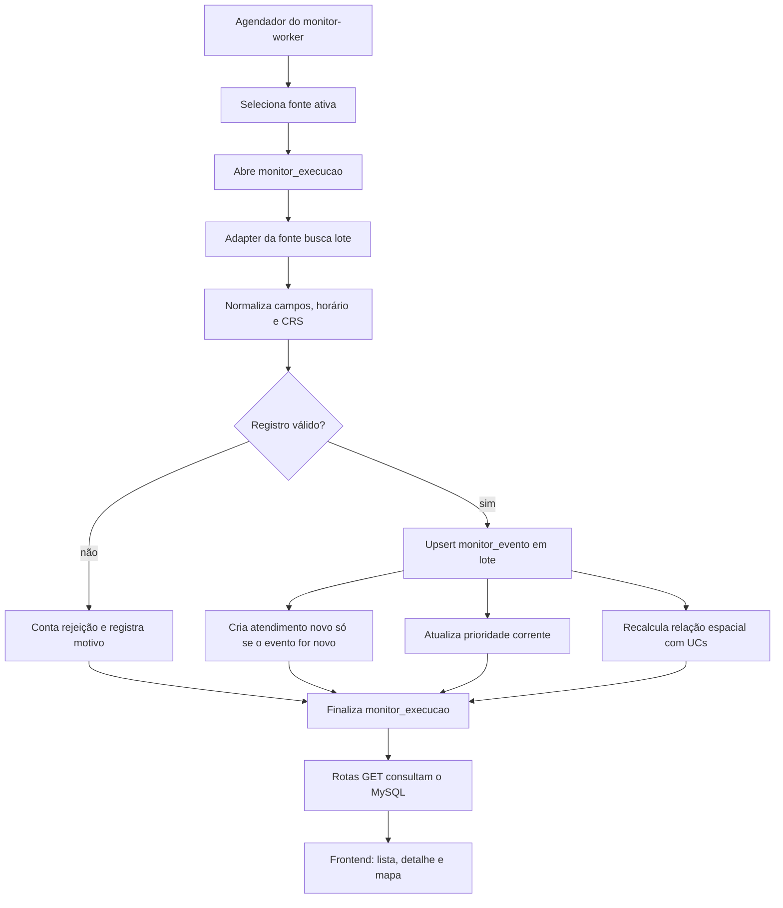

# Plano de ingestão e API de monitoramento ambiental

Este documento planeja a próxima etapa após a migration `003_monitoramento_ambiental.sql`:
buscar dados do INPE e do TerraBrasilis/DETER, normalizá-los, gravá-los nas tabelas
`monitor_*` e expô-los por rotas de leitura do BioGuardians. É planejamento; a
coleta, as rotas e os serviços descritos abaixo ainda não foram implementados.

## Decisões de arquitetura

- Executar a coleta em um processo `monitor-worker` separado da API Express. O
  worker pode reutilizar o runtime Node 22, `mysql2` e a configuração MySQL do
  backend, mas precisa de seu próprio comando de inicialização.
- Manter a API do BioGuardians somente GET. O worker grava nas tabelas de
  monitoramento; as rotas consultam e devolvem os dados.
- Registrar uma `monitor_execucao` por fonte e tentativa de coleta. Falha no
  DETER não impede a tentativa do INPE, e vice-versa.
- Usar `monitor_fonte.ativo` e `frequencia_minutos` como configuração da coleta.
  Começar com uma única réplica do worker. Se houver mais de uma, coordenar a
  execução com um lock no banco ou mecanismo equivalente.
- Fazer upsert por `(fonte_id, id_externo)`. Reimportar não duplica eventos e
  nunca reinicia ou sobrescreve `monitor_atendimento`.

## Fluxo

## Worker e adaptadores

### Ciclo de uma execução

1. Buscar em `monitor_fonte` fontes ativas cujo intervalo de coleta venceu.
2. Inserir `monitor_execucao` com `status = 'em_execucao'`, janela e parâmetros.
   Essa linha é criada antes do upsert porque `monitor_evento.ultima_execucao_id`
   aponta para a execução que gravou por último o registro.
3. Fazer a chamada HTTP fora de qualquer transação MySQL, com timeout, tentativas
   limitadas e espera progressiva entre tentativas.
4. Ler e normalizar os dados com o adapter específico da fonte.
5. Validar, separar registros aceitos dos rejeitados e processar os aceitos em
   lotes transacionais. Um lote inicial configurável (por exemplo, 200 itens)
   limita o tempo e o tamanho de cada transação.
6. Atualizar contagens e finalizar a execução como `concluida`, `parcial` ou
   `erro`, com horário final e resumo do erro, sem gravar payloads grandes nos
   logs.

Não manter uma transação aberta durante downloads. Também não apagar eventos que
não aparecerem em uma resposta parcial do WFS: ausência numa página ou numa
execução incompleta não significa que o alerta foi removido da fonte.

### Carga inicial e reprocessamento por CLI

Além do agendador, planejar um comando operacional para importar um CSV local,
fazer uma carga inicial controlada e reprocessar uma janela. O comando deve
chamar o mesmo parser, normalizador e serviço de persistência do worker; não criar
uma segunda implementação de ingestão. Incluir `--dry-run` e um limite opcional
de registros para conferir o mapeamento antes de gravar. A execução deve ser
registrada em `monitor_execucao`, inclusive quando houver erro ou rejeições.

Para o DETER, o adapter deve usar WFS com camada e CRS confirmados; uma carga de
arquivo baixado pode ser adicionada se o formato e a necessidade operacional
forem definidos. O acesso público aos alertas tem atraso de uma semana; o acesso
diário antecipado é restrito a instituições responsáveis por fiscalização.
Planejar a cadência e o ambiente de teste conforme essa disponibilidade. [FAQ do
TerraBrasilis](https://terrabrasilis.dpi.inpe.br/faq/)

### INPE / Programa Queimadas

A migration registra inicialmente o CSV diário do Brasil e uma frequência de
1.440 minutos. O primeiro adapter deve respeitar essa cadência. O INPE oferece
produtos em diferentes intervalos, incluindo 10 minutos e diário; se o requisito
for quase tempo real, cadastrar e mapear o produto de 10 minutos como outra fonte,
em vez de executar o CSV diário a cada 10 minutos. [Dados abertos do INPE](https://www.terrabrasilis.dpi.inpe.br/queimadas/portal/pages/secao_downloads/dados-abertos/index.html)

O parser deve mapear, após conferir o cabeçalho do arquivo real: horário da
detecção, satélite, país, estado, município, bioma, latitude, longitude, risco de
fogo e FRP. A FAQ do INPE documenta os campos `DataHora`, `Satelite`, `Estado`,
`Municipio`, `Bioma`, `RiscoFogo`, `Latitude`, `Longitude` e `FRP`; o código de
referência usa nomes diferentes, então o adapter deve aceitar aliases explícitos.
Horários GMT devem ser normalizados para UTC, e o ponto deve ser criado em SRID
4326 na ordem longitude/latitude. [FAQ do Programa Queimadas](https://terrabrasilis.dpi.inpe.br/queimadas/portal/pages/secao_informacoes/faq/index.html)

Usar o identificador estável publicado pelo INPE quando disponível. Se o produto
não trouxer um identificador utilizável, gerar uma chave determinística com os
campos documentados — por exemplo, horário, coordenadas e satélite — e guardar a
regra no adapter. Não inventar data de observação quando ela estiver ausente.

O backend ainda não inclui parser CSV. A implementação deve adicionar um parser
que respeite aspas e delimitadores; para arquivos maiores, preferir leitura em
stream em vez de carregar o arquivo inteiro em memória.

### TerraBrasilis / DETER

A fonte DETER permanece inativa no catálogo até configurar uma camada explícita,
seu CRS e o mapeamento de campos. Na preparação, consultar `GetCapabilities` e
`DescribeFeatureType`; durante as execuções, consultar a camada confirmada com
filtro temporal e paginação. Não escolher a primeira camada cujo nome contenha
“deter”. [FAQ do TerraBrasilis](https://terrabrasilis.dpi.inpe.br/faq/)

O adapter deve preservar o identificador da feição, a data, a classe publicada e
a geometria completa. Alertas poligonais devem continuar polígonos ou
multipolígonos em `monitor_evento.geom`; não converter o primeiro vértice em ponto.
Converter explicitamente o CRS da resposta para SRID 4326 e tratar a ordem dos
eixos conforme a versão WFS e `srsName` escolhidos. Confirmar também as condições
de acesso e atribuição antes de ativar a fonte; o TerraBrasilis documenta regras
específicas para acesso antecipado aos alertas. [Acesso aos dados do TerraBrasilis](https://terrabrasilis.dpi.inpe.br/acesso-aos-dados/)

## Normalização e validação

- Converter nomes de cabeçalho em aliases por fonte; preservar o objeto recebido
  em `propriedades_origem`.
- Mapear nomes de bioma e UF para `bioma.id` e `estado.uf`. Se não houver
  correspondência, manter o registro com FK nula quando a geometria e a identidade
  forem válidas, preservando o valor original no JSON.
- Armazenar município como nome e código IBGE quando houver um código confiável.
- Definir `precisao_data = 'instante'`, `'dia'` ou `'desconhecida'`; usar UTC para
  o valor armazenado. Data ausente fica nula, nunca substituída por `agora`.
- Validar coordenadas, geometria, SRID e valores não negativos de FRP/área. Para
  rejeições, incrementar `registros_rejeitados` e manter um resumo por motivo na
  execução e nos logs; não enviar linhas brutas completas aos logs.
- Converter a área DETER para hectares só depois de verificar a unidade da camada;
  preservar valores e campos originais em `propriedades_origem`.

## Aplicação ao banco

Para cada lote aceito:

1. Gravar `monitor_evento` com a fonte, o tipo, `id_externo`, `geom`, campos
   normalizados, JSON original, `ultima_execucao_id` e `ultima_vista_em`.
2. Em conflito da chave única `(fonte_id, id_externo)`, atualizar os fatos da
   fonte e a última execução, sem modificar as tabelas de atendimento.
3. Garantir um `monitor_atendimento` para cada evento. Se ainda não existir,
   criar status `novo` e a primeira linha de `monitor_atendimento_historico` na
   mesma transação. Se já existir, preservar status, responsável e histórico.
4. Atualizar a linha corrente de `monitor_prioridade` com a versão do algoritmo.
   A fórmula é interna; sua frequência de recálculo precisa considerar os limites
   de recência sem criar escritas inúteis a cada coleta.
5. Atualizar `monitor_evento_uc` em uma etapa espacial separada: ponto contido na
   UC ou polígono que intersecta a UC. Usar o índice espacial e não adicionar
   triggers pesados às tabelas existentes.

## Rotas GET propostas

Registrar um novo router em `backend/src/routes/monitoramento.ts` e montá-lo em
`backend/src/index.ts` sob `/api/monitoramento`. Reutilizar `query`,
`validateId`, `parseBbox`, `getPaginationParams` e o middleware de cache.

| Rota | Resposta |
|---|---|
| `GET /api/monitoramento/eventos` | Lista paginada com filtros `tipo`, `fonte`, `bioma_id`, `estado_uf`, `desde`, `ate`, `status`, `prioridade` e `bbox`. `per_page` limitado a 100. |
| `GET /api/monitoramento/eventos/:id` | Detalhe do evento como GeoJSON, prioridade corrente, status, histórico e UCs relacionadas. |
| `GET /api/monitoramento/resumo` | Totais por tipo, prioridade, status e bioma, com período opcional. |
| `GET /api/monitoramento/fontes` | Fontes ativas e última execução, incluindo horário, resultado e contagens. |
| `GET /api/monitoramento/execucoes/:id` | Detalhe de uma execução de coleta e seu resumo de erro. |
| `GET /api/monitoramento/eventos/tiles/:z/:x/:y.mvt` | Tiles vetoriais dos focos e alertas; implementar depois da listagem/detalhe e confirmar volume e necessidade do mapa. |

Filtros devem ser validados por allowlist e sempre parametrizados com `?`. Para
`bbox`, usar `MBRIntersects` para reduzir candidatos pelo índice espacial e a
interseção exata quando necessário. A lista deve devolver poucos campos e
paginar; a geometria completa fica no detalhe ou no tile. Aplicar TTL curto às
rotas de dados e resumo porque o worker pode atualizar o banco sem invalidar o
LRU da API.

## Status e atendimento

As rotas acima só leem status e histórico. O backend tem CORS e contrato
GET-only; portanto não serão incluídas rotas PUT/POST para iniciar ou resolver
alertas nesta etapa. O worker cria o estado inicial `novo`. Alterações humanas
para `em_andamento` e `resolvido` exigem uma decisão de arquitetura e autorização
explícita antes de expor qualquer escrita, com ator autenticado e histórico na
mesma transação.

## Etapas de implementação

1. **Fechar contrato das fontes:** escolher cadência INPE; validar cabeçalho CSV;
   identificar camada(s), campos, CRS e paginação DETER.
2. **Worker e execução:** criar o processo singleton, scheduler por fonte,
   tabela de execução, timeout, retry e logs estruturados.
3. **Adapter INPE:** parsear CSV, normalizar, validar e fazer upsert idempotente;
   inicializar atendimento somente para eventos novos.
4. **Adapter DETER:** habilitar depois de confirmar os metadados; manter a
   geometria poligonal e paginar por data.
5. **Rotas de leitura:** listar, detalhar, resumir e mostrar saúde das fontes;
   montar o router no servidor e aplicar paginação/cache.
6. **Mapa:** adicionar tiles MVT e integração visual quando a volumetria justificar.
7. **Atendimento humano:** decidir separadamente como autorizar escritas sem
   violar o contrato GET-only da API.

## Critérios para considerar a ingestão pronta

- Uma execução grava contagens e resultado por fonte; a falha de uma fonte não
  bloqueia a outra.
- Reexecutar a mesma janela não duplica eventos nem altera status de atendimento.
- Os pontos INPE e polígonos DETER são armazenados em SRID 4326 com geometria
  preservada.
- O evento recém-descoberto recebe status `novo` e seu registro inicial de
  histórico; eventos conhecidos não ganham histórico falso a cada coleta.
- Data ausente permanece nula e registros inválidos aparecem nas contagens de
  rejeição.
- A API retorna páginas limitadas e apenas métodos GET; o status da coleta pode
  ser consultado sem tornar o healthcheck geral dependente de um feed externo.

## Plano de validação

1. **Parser offline:** manter um pequeno fixture baseado no cabeçalho e em linhas
   representativas do CSV oficial do INPE; validar aliases, aspas, datas GMT,
   coordenadas, valores ausentes e rejeições sem depender da rede.
2. **Integração MySQL 8.4:** em banco descartável, aplicar as migrations e
   importar o fixture. Conferir contagens da execução, geometria SRID 4326,
   relacionamentos, atendimento `novo` e histórico inicial.
3. **Idempotência:** importar o mesmo fixture de novo; confirmar que não duplica
   eventos nem cria histórico repetido. Preparar o evento com status diferente
   de `novo` no banco descartável e confirmar que o upsert preserva esse estado.
4. **API:** consultar lista, detalhe, resumo e execução após a carga e verificar
   filtros, paginação e GeoJSON. Continuar usando apenas GET.
5. **Smoke test com fonte real:** em ambiente local ou de staging, baixar um CSV
   oficial de escopo limitado, registrar URL/data/checksum da entrada e executar
   o fluxo até consultar o evento pela API. Repetir a importação para verificar
   deduplicação. Não depender da rede externa no CI.
6. **DETER ao habilitar:** consultar uma janela pequena na camada WFS confirmada;
   conferir paginação, CRS, geometria poligonal e atribuição. Não habilitar a
   fonte enquanto os metadados e o acesso não estiverem validados.

O smoke test real complementa os testes com fixture: verifica disponibilidade,
formato atual da fonte, compatibilidade com MySQL e exposição pela API. Deve usar
banco descartável ou staging, nunca uma carga exploratória direto em produção.
