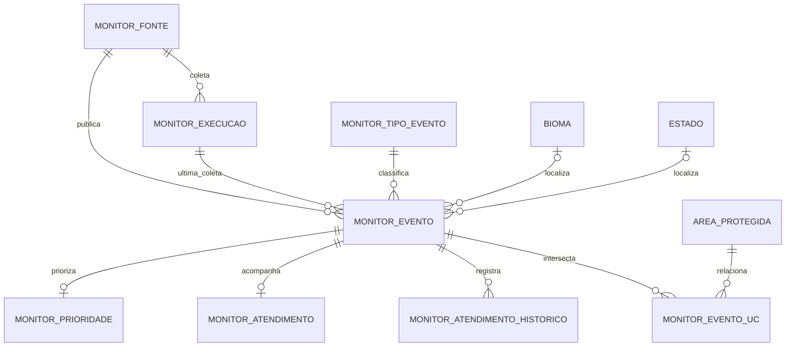

# Modelagem de monitoramento ambiental

Este domínio reúne focos de calor do INPE / Programa Queimadas e alertas de
alteração da cobertura vegetal do DETER publicados pelo TerraBrasilis. Ele é
aditivo: um alerta ambiental não é uma ocorrência de espécie (`ocorrencia`) nem
uma classificação de imagem (`deteccao`).

O schema foi criado em `003_monitoramento_ambiental.sql`. A migration
`004_activate_terrabrasilis_deter.sql` configura e ativa as camadas públicas do
DETER Amazônia e Cerrado. Consulte também o [dicionário de dados](DATA_DICTIONARY.md)
e o [ERD](ERD.md).

## Diagrama



## Tabelas

### `monitor_fonte`

Catálogo de produtos consultados. Guarda código estável, órgão, formato,
endpoint, camada WFS quando aplicável, CRS publicado, frequência e instrução de
atribuição. A migration `003` cria uma fonte DETER genérica inativa; a `004`
substitui essa entrada pela camada pública de Amazônia e adiciona a fonte do
Cerrado.

Fontes atualmente ativas:

| Código | Produto e endpoint/camada | Frequência |
|---|---|---:|
| `inpe_queimadas_diario_br` | CSV diário do Brasil em `https://dataserver-coids.inpe.br/queimadas/queimadas/focos/csv/diario/Brasil/focos_diario_br_{yyyymmdd}.csv` | 1.440 min |
| `terrabrasilis_deter_amazonia_wfs` | `https://terrabrasilis.dpi.inpe.br/geoserver/deter-amz/wfs`, camada `deter-amz:deter_amz` | 1.440 min |
| `terrabrasilis_deter_cerrado_wfs` | `https://terrabrasilis.dpi.inpe.br/geoserver/deter-cerrado-nb/wfs`, camada `deter-cerrado-nb:deter_cerrado` | 1.440 min |

As duas camadas DETER são feeds públicos com atraso aproximado de uma semana.
O acesso antecipado diário requer credenciais e não é usado por esta integração.
O [TerraBrasilis](https://terrabrasilis.dpi.inpe.br/) publica os dados e as
orientações de uso e atribuição.

### `monitor_tipo_evento`

Referência dos tipos `foco_calor` e `alerta_deter`. O nome “alerta DETER” mantém
a distinção entre um alerta de sensoriamento remoto e a confirmação de
desmatamento.

### `monitor_execucao`

Uma linha por tentativa de coleta: fonte, estado (`em_execucao`, `concluida`,
`parcial` ou `erro`), janela, parâmetros, contagens, checksum SHA-256 e erro.
Cada evento aponta para sua execução mais recente; uma FK composta garante que
evento e execução pertençam à mesma fonte.

### `monitor_evento`

Representa o item publicado pela fonte. A chave única `(fonte_id, id_externo)`
permite reimportação idempotente. `geom` é `GEOMETRY SRID 4326`: ponto para foco
de calor e polígono/multipolígono para DETER. GeoJSON usa longitude/latitude;
essa ordem é mantida ao gravar no MySQL. A data original e sua precisão ficam em
`data_observacao` e `precisao_data`; a carga não inventa a data quando a fonte
não a fornece.

`bioma_id` e `estado_uf` reutilizam tabelas existentes. Município e código IBGE
são opcionais. Os atributos normalizados ficam em colunas e o conjunto de
atributos publicado fica preservado em `propriedades_origem` (JSON). Os campos
específicos de fogo são `satelite`, `risco_fogo` e `frp_mw`; para DETER, são
`classe_fonte` e `area_alerta_ha`.

### `monitor_prioridade`

Estrutura para guardar uma avaliação de prioridade do BioGuardians: componentes
de risco, recência e sensibilidade, score final, nível e versão do algoritmo.
Não é uma avaliação oficial das fontes. O cálculo ainda não está implementado e
o importador atual não preenche esta tabela; por isso os campos de prioridade
podem aparecer sem valor na API.

### `monitor_atendimento` e `monitor_atendimento_historico`

Todo evento novo recebe o status inicial `novo` e uma linha inicial no histórico,
com ator `sistema`. Reimportar um evento atualiza os dados publicados sem
reiniciar o atendimento nem duplicar esse registro inicial.

O schema também define os valores `em_andamento` e `resolvido`, mas a aplicação
atual expõe apenas consultas `GET` e não oferece operação para mudar o status.
Não existe hoje uma transição de atendimento disponível pelo produto; a
identidade de ator e o fluxo de resolução dependem de uma futura funcionalidade
de escrita autorizada.

### `monitor_evento_uc`

Relação espacial muitos-para-muitos com `area_protegida`. O importador a
recalcula para os eventos importados: um ponto é relacionado à UC que o contém;
um polígono, às UCs que intersecta. Para interseções poligonais, o banco calcula
`intersecao_ha` a partir da geometria de interseção; para pontos o campo fica
nulo. O processo ocorre na ingestão, sem triggers espaciais em cada leitura.

## Mapeamento das fontes

### INPE / Programa Queimadas

O CSV diário do Brasil alimenta eventos `foco_calor`. O importador reconhece
variações de cabeçalho para data/hora, latitude, longitude, município, código
IBGE, estado, bioma, satélite, risco de fogo e FRP. Quando o registro contém um
identificador de origem, ele é usado como `id_externo`; quando não contém, o
importador cria um SHA-256 determinístico dos atributos de identificação.
Coordenadas inválidas e datas malformadas são contabilizadas como rejeições.
Esse produto tem frequência diária; não representa um feed de atualização a
cada 10 minutos.

### TerraBrasilis / DETER

As fontes ativas são os WFS públicos `deter-amz:deter_amz` e
`deter-cerrado-nb:deter_cerrado`. A migration registra CRS de origem EPSG:4674;
as consultas pedem GeoJSON em EPSG:4326, e o parser rejeita resposta em CRS não
suportado. A geometria Polygon/MultiPolygon completa é preservada.

O importador usa `view_date` como data de observação, `classname` como classe,
`gid`/ID da feature como identificador, e os campos disponíveis de estado,
município, código municipal e satélite. A área do alerta é calculada em hectares
a partir da geometria. Os atributos originais ficam no JSON da feature.

As consultas WFS filtram feições correntes (`gid` terminado em `curr`) a partir
da data inicial solicitada. A janela padrão é de 30 dias, as páginas têm até 500
feições, e a coleta usa checksum do conteúdo recebido. A paginação e a chave
externa tornam seguro repetir a importação da janela.

## Execução da ingestão

O CLI fica em `backend/`:

```bash
npm run monitor:import -- --source inpe_queimadas_diario_br --date YYYY-MM-DD
npm run monitor:import -- --source terrabrasilis_deter_amazonia_wfs --since YYYY-MM-DD
npm run monitor:import -- --source terrabrasilis_deter_cerrado_wfs --janela-dias 30 --dry-run
```

CSV aceita `--date`; WFS aceita `--since` ou `--janela-dias`. Ambas as fontes
aceitam `--limit`, `--file` e `--dry-run` conforme o formato. O serviço
`monitor-worker`, no Docker Compose de desenvolvimento, verifica o catálogo a
cada minuto, mas coleta cada fonte somente quando o intervalo configurado vence.
Um lock nomeado do MySQL evita dois workers ativos ao mesmo tempo.

## API

A API de monitoramento é somente leitura:

| Rota | Uso |
|---|---|
| `GET /api/monitoramento/eventos` | Lista GeoJSON com filtros por tipo, fonte, bioma, estado, data, status, prioridade e bbox |
| `GET /api/monitoramento/eventos/:id` | Detalhe, histórico inicial e UCs intersectadas |
| `GET /api/monitoramento/resumo` | Totais por tipo, status, prioridade e bioma |
| `GET /api/monitoramento/fontes` | Catálogo e resultado da última execução |
| `GET /api/monitoramento/execucoes/:id` | Resultado e contagens de uma execução |

Não há `POST`, `PUT` ou `DELETE` nessas rotas. As rotas não alteram eventos nem
status de atendimento.

## Objetos reutilizados

- `bioma` e `estado` normalizam a localização quando a fonte tem esses dados.
- `area_protegida` fornece os limites das Unidades de Conservação.
- `ocorrencia` e `ocorrencia_area` continuam reservadas a registros de espécies.
- `deteccao` continua reservada às classificações de imagens.
