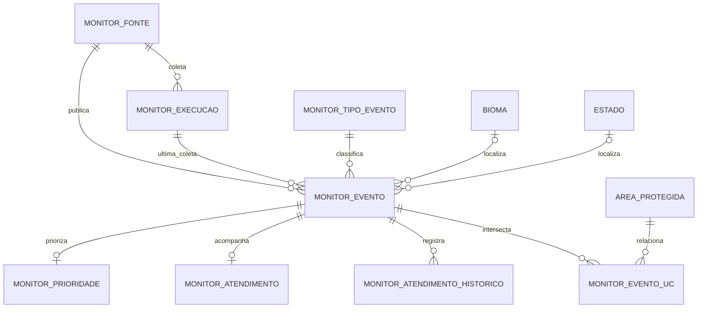

# Modelagem de monitoramento ambiental

Modelo MySQL para integrar focos de calor do INPE / Programa Queimadas e alertas
do sistema DETER publicados pelo TerraBrasilis. O schema é aditivo: os alertas
ambientais não são armazenados como ocorrências de espécies.

Migration correspondente: `db/migrations/003_monitoramento_ambiental.sql`.

## Diagrama

## Tabelas

### `monitor_fonte`

Catálogo dos produtos consultados, não apenas do órgão publicador. Guarda código
estável, órgão, produto, formato, endpoint, camada WFS, CRS de origem, frequência
esperada e orientação de atribuição. A fonte DETER é criada inativa até que a
camada WFS e seu CRS sejam confirmados.

### `monitor_tipo_evento`

Referência extensível dos tipos `foco_calor` e `alerta_deter`. O nome alerta
DETER preserva a distinção entre um alerta de sensoriamento remoto e uma
confirmação de desmatamento.

### `monitor_execucao`

Uma linha por tentativa de coleta, com estado (`em_execucao`, `concluida`,
`parcial` ou `erro`), janela consultada, parâmetros, contagens, checksum do
arquivo quando aplicável e erro. Cada evento aponta para a última execução que
o importou; uma chave estrangeira composta garante que fonte do evento e fonte
da execução sejam iguais.

### `monitor_evento`

Registro atual de um item publicado por uma fonte. A chave única
`(fonte_id, id_externo)` torna o carregamento idempotente. O importador deve usar
o identificador estável da fonte; se não existir, deve produzir e documentar uma
chave determinística a partir dos atributos de origem.

`geom` é `GEOMETRY SRID 4326` com índice espacial: ponto para foco de calor e
polígono/multipolígono para alerta DETER. Coordenadas GeoJSON são longitude /
latitude; a conversão deve ser explícita ao gravar no MySQL. A data da fonte é
armazenada em UTC. Quando a fonte só informa o dia, usar `precisao_data = 'dia'`;
quando não informa a data, deixar `data_observacao` nula em vez de substituí-la
pelo horário da importação.

O vínculo com `bioma` e `estado` usa as referências existentes. Município fica
como texto e código IBGE opcional, pois ainda não há tabela municipal neste
schema. Campos comuns ficam em colunas; `propriedades_origem` preserva o JSON
original para rastreabilidade e remapeamentos futuros.

Campos de fogo: `satelite`, `risco_fogo` e `frp_mw`. Campos de alertas: `classe_fonte`
e `area_alerta_ha`; o importador converte a unidade publicada para hectares e
mantém o valor/fator original em `propriedades_origem`.

### `monitor_prioridade`

Uma linha com a avaliação corrente por evento: componentes de risco, recência e
sensibilidade, score final, nível e versão do algoritmo. É uma regra interna do
BioGuardians, não um valor oficial do INPE ou do DETER. A tabela é atualizada
quando o score é recalculado; os fatos originais permanecem em
`monitor_evento`.

### `monitor_atendimento` e `monitor_atendimento_historico`

`monitor_atendimento` mantém o estado corrente, inicialmente `novo`, e os
horários de início e resolução. `monitor_atendimento_historico` é append-only e
registra status anterior/novo, data, ator e observação. A primeira importação
deve criar o estado `novo` e seu evento inicial no histórico.

Transições da primeira versão: `novo → em_andamento → resolvido`. Reimportar um
evento não altera nem reinicia o atendimento. Cada transição atualiza a linha
corrente e insere o histórico na mesma transação. O ator deve vir da identidade
autenticada da API; até existir essa identidade, usar `sistema` para mudanças
automáticas. Reabertura de evento não está incluída no fluxo de referência.

### `monitor_evento_uc`

Relação espacial muitos-para-muitos com `area_protegida`. Para pontos, a relação
significa que o foco está contido na UC. Para polígonos, significa interseção;
`intersecao_ha` pode ficar nula na primeira versão. O vínculo é recalculado pelo
worker após a ingestão, sem triggers pesados em `area_protegida` ou no evento.

## Mapeamento das fontes

### INPE / Programa Queimadas

O CSV diário do Brasil alimenta eventos `foco_calor`. Mapear horário, satélite,
bioma, estado, município, latitude, longitude, risco de fogo e FRP. O parser
deve aceitar os nomes exatos da versão do CSV configurada, pois a documentação
e o código de referência usam cabeçalhos diferentes. Se o requisito exigir
atualização em intervalos de 10 minutos, cadastrar o produto correspondente do
INPE; não configurar o CSV diário como se fosse um feed de 10 minutos.

### TerraBrasilis / DETER

Antes de ativar a fonte, consultar `GetCapabilities` e `DescribeFeatureType`,
definir uma camada explícita, verificar campos, paginação, intervalo temporal e
CRS. Guardar o identificador da feição, a data e a classe publicada e preservar
a geometria completa. Não extrair apenas o primeiro vértice de um polígono nem
inventar a data do alerta quando ela estiver ausente.

## Regras operacionais de integração

- O worker grava os eventos e atualiza `ultima_execucao_id` e `ultima_vista_em`.
- Upserts nunca escrevem em `monitor_atendimento` nem em seu histórico.
- A API de leitura pode expor alertas, prioridades, status e histórico por GET.
- Alterar status exige uma rota de escrita autenticada e autorização do ator; a
  API atual do BioGuardians é somente GET.
- A camada DETER permanece inativa no catálogo até seus metadados terem sido
  verificados. O endpoint é público, mas acesso e atribuição precisam seguir as
  condições publicadas pelo TerraBrasilis.

## Objetos existentes reutilizados

- `bioma` e `estado` normalizam localizações.
- `area_protegida` fornece os limites das UCs.
- `ocorrencia` e `ocorrencia_area` continuam reservadas a registros de espécies.
- `deteccao` continua reservada a resultados do serviço de classificação de
  imagens.
