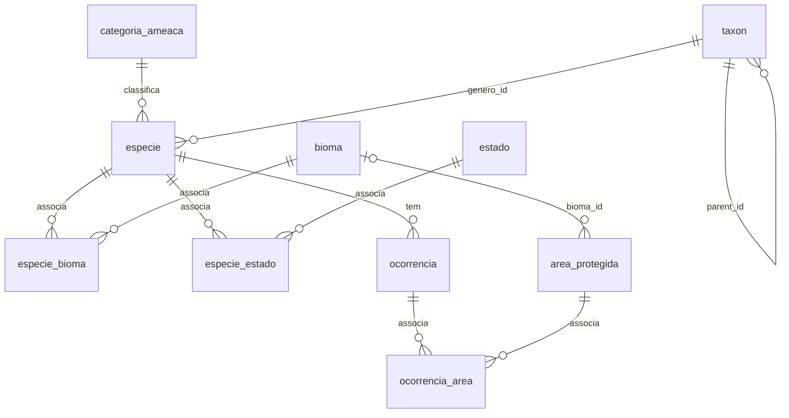
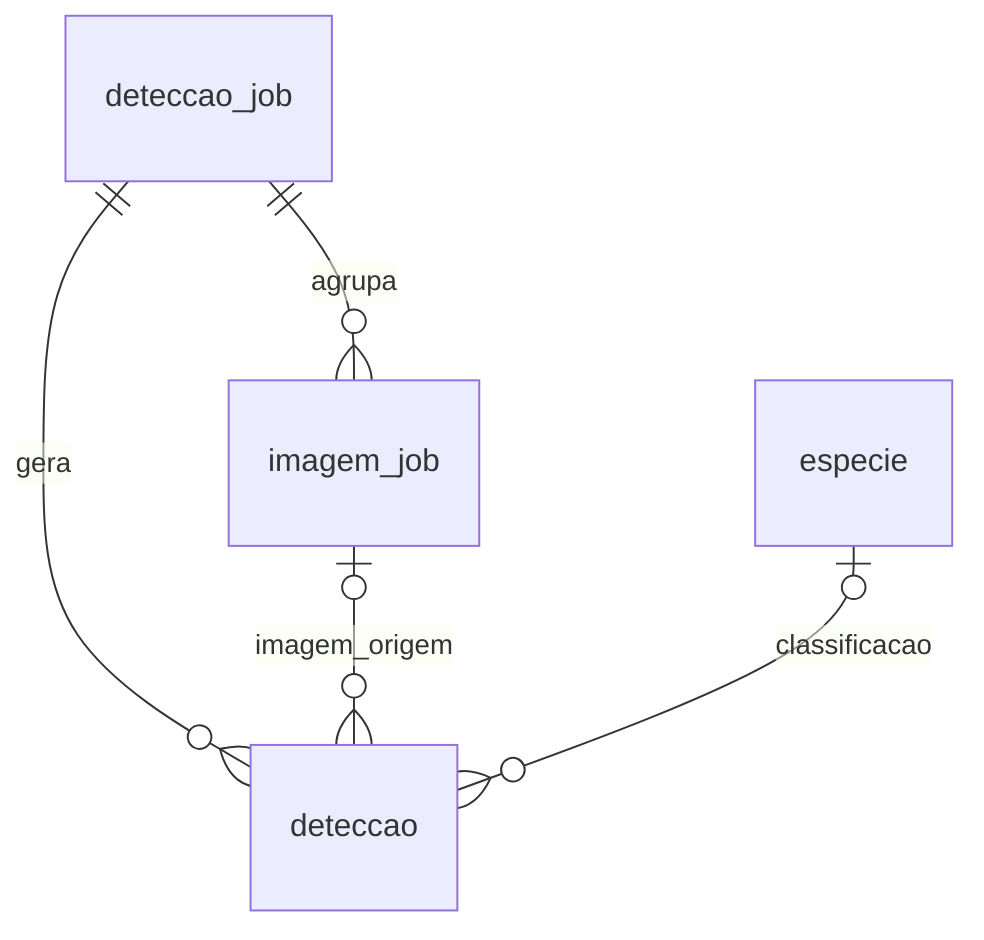
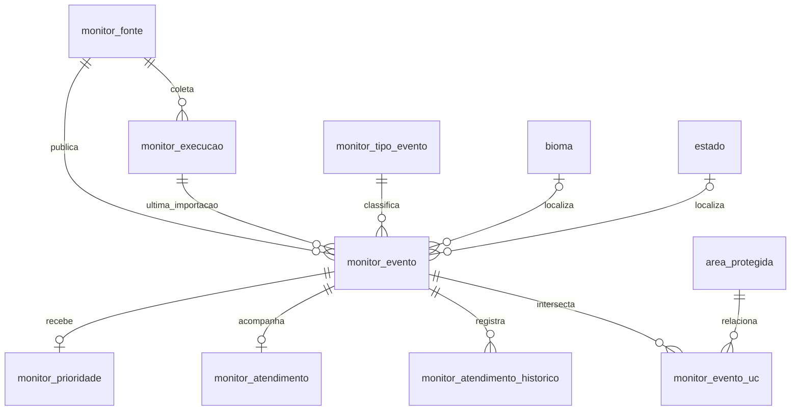

# BioGuardians — Modelo Entidade-Relacionamento (ERD)

Visão dos relacionamentos no schema MySQL atual (migrations `001`–`004`). Os
campos do domínio ambiental estão detalhados no
[dicionário de dados](DATA_DICTIONARY.md) e na
[modelagem de monitoramento](ENVIRONMENTAL_MONITORING_MODEL.md).

## Biodiversidade e áreas protegidas

- `taxon` representa a hierarquia reino → filo → classe → ordem → família →
  gênero; a espécie referencia o gênero.
- `especie_bioma` e `especie_estado` implementam relações N:N.
- `ocorrencia_area` guarda as UCs que contêm uma ocorrência. Triggers atualizam
  essa relação quando a ocorrência ou a geometria da UC muda.
- `log_auditoria` registra alterações em `especie` e `area_protegida` por
  triggers; não possui FK para as tabelas auditadas.

## Classificação de imagens

`imagem_job` tem unicidade por `(source, source_image_id)` para permitir
checkpoint idempotente. `modelo_ml` cataloga modelos e não tem relacionamento
direto com as detecções.

## Monitoramento ambiental

- A chave `(fonte_id, id_externo)` identifica um evento da fonte e dá suporte a
  reimportações idempotentes.
- A FK composta entre evento e execução garante que ambos pertençam à mesma
  fonte.
- `monitor_evento_uc` relaciona eventos às UCs por contenção de ponto ou
  interseção de polígonos, calculada durante a ingestão.
- Um evento importado recebe atendimento inicial `novo` e um registro de
  histórico. A API é somente GET e não permite transições para
  `em_andamento` ou `resolvido`.
- `monitor_prioridade` está no schema, mas ainda não é preenchida por um cálculo
  automático.

## Relações principais

| Entidade 1 | Relação | Entidade 2 | Cardinalidade | Implementação |
|---|---|---|---|---|
| `categoria_ameaca` | classifica | `especie` | 1:N | FK |
| `taxon` (gênero) | classifica | `especie` | 1:N | FK |
| `taxon` pai | contém | `taxon` filho | 1:N | FK autorreferenciada |
| `especie` | associada a | `bioma` | N:N | `especie_bioma` |
| `especie` | associada a | `estado` | N:N | `especie_estado` |
| `bioma` | localiza | `area_protegida` | 1:N opcional | FK |
| `especie` | tem | `ocorrencia` | 1:N | FK |
| `ocorrencia` | contida em | `area_protegida` | N:N espacial | `ocorrencia_area` |
| `deteccao_job` | agrupa | `imagem_job` | 1:N | FK |
| `deteccao_job` | gera | `deteccao` | 1:N | FK |
| `monitor_fonte` | publica | `monitor_evento` | 1:N | FK |
| `monitor_fonte` | registra | `monitor_execucao` | 1:N | FK |
| `monitor_evento` | recebe | `monitor_prioridade` | 1:0..1 | FK |
| `monitor_evento` | inicia | `monitor_atendimento` | 1:0..1 | FK |
| `monitor_evento` | registra | `monitor_atendimento_historico` | 1:N | FK |
| `monitor_evento` | intersecta | `area_protegida` | N:N espacial | `monitor_evento_uc` |

## Índices espaciais e de consulta

O MySQL cria índices espaciais com `SPATIAL KEY`; os demais índices são B-tree.
Entre os principais estão:

- `area_protegida.geom`, `ocorrencia.geom`, `deteccao.geom` e
  `monitor_evento.geom` para filtros espaciais.
- `(especie_id, data_evento)` em `ocorrencia` para ocorrências recentes por
  espécie.
- `(tipo_evento_codigo, data_observacao)`, `(bioma_id, data_observacao)` e
  `(estado_uf, data_observacao)` em `monitor_evento` para filtros por período.
- Chaves compostas das tabelas de relação e `(z, x, y)` em `area_tile`.

As tabelas `dashboard_stats`, `especies_por_uc`,
`ranking_especies_categoria` e `ucs_por_esfera` são tabelas comuns, preenchidas
por `CALL refresh_dashboard()`; não são views materializadas.
